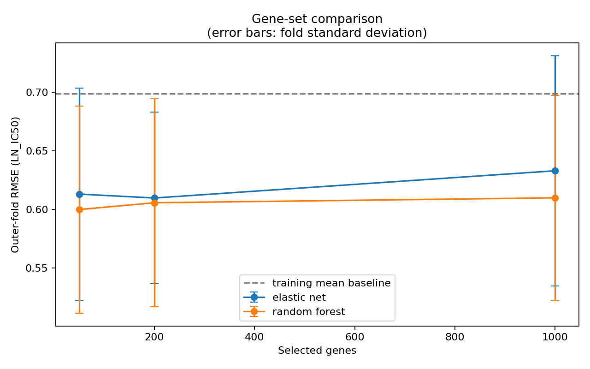
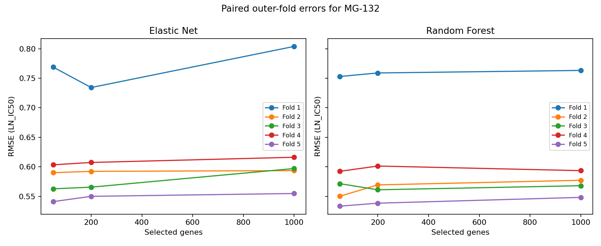

# MG-132 gene-set comparison

## Study and primary findings

The study evaluates MG-132 (GDSC2 drug ID 1862) in 944 matched cell lines.
Drug selection was frozen before model fitting using maximum matched coverage.
The lowest mean outer-fold RMSE is 0.6000, from random_forest with
50 genes; the training-mean baseline RMSE is 0.6987.
The lowest observed model RMSE is 14.1% below the baseline mean RMSE.
This identifies the best observed configuration in this comparison, not an independently
validated winner. Larger gene sets must be judged using the paired fold differences below.

## Data and preprocessing

Drug responses: GDSC2 fitted dose responses dated 27 October 2023. Expression:
CMP merged RSEM TPM archive dated 22 September 2025. Model annotations: 13 October 2026.
Expression is supplied as log2(TPM+1), preserved without another log transformation.
Sanger model IDs join the sources directly. Fourteen rows with duplicated Ensembl
IDs were excluded without inspecting responses, leaving 41,131 input genes.
The expression matrix member passed its ZIP CRC check. Source SHA-256 hashes are in
the committed study design and run manifest. All 944 matched models are cell lines;
their expression sources comprise 547 Broad and 397 Sanger measurements across 28 tissues.
Of 969 MG-132 response cell lines, 25 lacked matched expression. There were no missing
MG-132 responses or duplicate MG-132 cell-line rows in the downloaded workbook.

## Evaluation protocol

Five shuffled outer folds (seed 42) estimate performance; three shuffled inner folds
tune parameters by RMSE. Every training fold independently filters genes with more
than 20% missingness, imputes medians, removes zero-variance genes, and ranks genes by
absolute Pearson correlation with response. Elastic net also standardizes using
training statistics. Both models use the same ranking and outer splits.
Elastic net uses seeded random coordinate updates and retries unconverged fits with
increasing iteration budgets; persistent nonconvergence raises an error. An initial
cyclic-coordinate trial was stopped after convergence warnings, before any complete
outer fold was reported. The final study reruns all configurations.
The elastic-net grid is alpha 0.01/0.1/1 and l1 ratio 0.1/0.5/0.9. Random forests use
200 trees, max_features 0.3/1, and min_samples_leaf 2/5. Refit preprocessing is learned
on the complete outer training fold after tuning. No test-fold targets enter fitting.
Cached preprocessing reuses only identical training inputs and parameters.

## Performance

Values are means and sample standard deviations across five outer folds.
RMSE and MAE are in LN_IC50 units; R2 is calculated separately in each test fold.

| model | gene_count | rmse_mean | rmse_std | mae_mean | mae_std | r2_mean | r2_std |
| --- | --- | --- | --- | --- | --- | --- | --- |
| elastic_net | 50 | 0.6132 | 0.0903 | 0.4508 | 0.0440 | 0.2067 | 0.0603 |
| elastic_net | 200 | 0.6098 | 0.0731 | 0.4452 | 0.0332 | 0.2106 | 0.0704 |
| elastic_net | 1000 | 0.6331 | 0.0980 | 0.4592 | 0.0455 | 0.1552 | 0.0725 |
| mean_baseline | 0 | 0.6987 | 0.1086 | 0.5029 | 0.0525 | -0.0259 | 0.0216 |
| random_forest | 50 | 0.6000 | 0.0883 | 0.4398 | 0.0422 | 0.2403 | 0.0601 |
| random_forest | 200 | 0.6058 | 0.0885 | 0.4412 | 0.0361 | 0.2262 | 0.0458 |
| random_forest | 1000 | 0.6100 | 0.0872 | 0.4457 | 0.0383 | 0.2142 | 0.0589 |

## Paired gene-count comparisons

Negative differences favor the larger gene set. The number of favorable folds helps
show whether an average difference is consistent. These dependent CV folds do not
provide an independent replication study, and no equivalence claim is made.

| model | smaller_genes | larger_genes | mean_rmse_difference | folds_larger_better |
| --- | --- | --- | --- | --- |
| elastic_net | 50 | 200 | -0.0033 | 1 |
| elastic_net | 50 | 1000 | 0.0199 | 0 |
| elastic_net | 200 | 1000 | 0.0232 | 0 |
| random_forest | 50 | 200 | 0.0058 | 1 |
| random_forest | 50 | 1000 | 0.0100 | 1 |
| random_forest | 200 | 1000 | 0.0042 | 1 |

## Tissue and expression-source diagnostics

Supplementary metadata-only baselines predict a tissue-specific or source-specific
training mean using the same outer folds; unseen categories fall back to the overall
training mean. These diagnostics were not used to choose the drug or tune the models.
Their results help assess whether coarse tissue/source differences are predictive;
they do not remove confounding from the expression models.

| baseline | rmse | mae | r2 |
| --- | --- | --- | --- |
| expression_source_training_mean | 0.6972 | 0.5006 | -0.0212 |
| tissue_training_mean | 0.6759 | 0.4820 | 0.0306 |

## Selected genes

`annotated_gene_stability.csv` lists selection frequency and model weights.
`top_genes_50.csv` provides a compact list for biological review. Selection frequency
is descriptive: outer training sets overlap. Elastic-net coefficients refer to
standardized expression; random-forest impurity importance has no effect direction
and can be biased. Neither establishes causation or a drug-specific mechanism.

## Limitations

This is internal evaluation of one drug and dataset. Random cell-line folds permit
shared tissue and source composition across folds; they do not test generalization
to unseen tissues, patients, or laboratories. The annotation audit found no shared
patient IDs among matched models, but relatedness was not independently validated.
The merged expression sources may carry batch differences; source adjustment was not
performed. Fitted LN_IC50 values have assay/model uncertainty. Outlying responses
were retained under the prespecified rules and can affect RMSE. There is no external
test dataset or clinical validation. Similar means do not demonstrate equivalence.
MG-132 is a laboratory proteasome inhibitor; results must not be presented as patient
treatment recommendations. Biological interpretation remains exploratory.

## Sources

- [Official expression processing documentation](https://depmap.sanger.ac.uk/documentation/datasets/expression/)
- [Official GDSC assay and fitted-response documentation](https://depmap.sanger.ac.uk/documentation/datasets/drug-sensitivity/)
- [Official dataset downloads](https://cellmodelpassports.sanger.ac.uk/downloads)
- [MG132 proteasome and calpain effects in an experimental study](https://www.jci.org/articles/view/119513)
